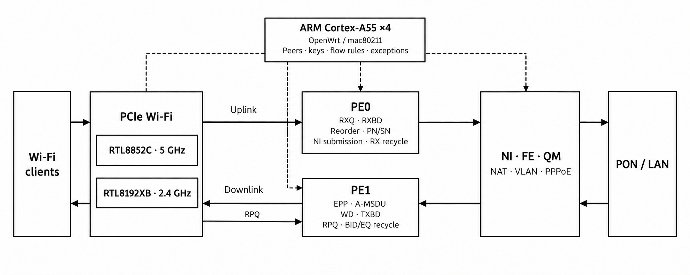

<h1 align="center">PonWRT · TYFZA1</h1>

<p align="center">
  天翼 TYFZA1 的 OpenWrt 固件<br>
  PON 光口 · 双频 Wi-Fi 6 · 硬件加速
</p>

<p align="center">
  <a href="https://github.com/LeoooChen/PonWRT-TYFZA1/releases"></a>
  <a href="https://github.com/LeoooChen/PonWRT-TYFZA1/actions/workflows/build-release.yml"></a>
  <a href="COPYING"></a>
</p>

<p align="center">
  <a href="#下载固件">下载固件</a> ·
  <a href="#刷入">刷入指南</a> ·
  <a href="#wi-fi-硬件加速">Wi-Fi 硬件加速</a> ·
  <a href="RELEASE_NOTES.md">更新日志</a> ·
  <a href="https://github.com/LeoooChen/PonWRT-TYFZA1/issues">问题反馈</a>
</p>

## 关于项目

PonWRT-TYFZA1 是面向天翼 TYFZA1 光猫的 OpenWrt 适配项目。设备采用 Realtek RTL9617C 四核 Cortex-A55，固件基于 Linux 6.18.55。

- **PON 适配**：10G-EPON、XG-PON 线路认证、业务配置和状态管理。
- **双频无线**：2.4 GHz / 5 GHz、WPA2、Wi-Fi 6 和 160 MHz。
- **硬件加速**：有线与 Wi-Fi 双向硬件转发，可在 LuCI 中启用流量卸载。
- **原生体验**：使用 LuCI 管理上网、无线和防火墙，通过 sysupgrade 升级。
- **原厂数据保留**：启动时自动读取本机身份、光学校准和无线校准；扩容时将原厂配置与应用数据保存为两份压缩副本。

## 下载固件

前往 **[Releases](https://github.com/LeoooChen/PonWRT-TYFZA1/releases)** 下载适用于原生 U-Boot 的固件，版本变化见 [更新日志](RELEASE_NOTES.md)。

| 文件 | 用途 |
| --- | --- |
| `sysupgrade.bin` | 原生 U-Boot 首次安装 / OpenWrt 升级 |
| `SHA256SUMS` | 核对下载文件的 SHA-256 |

## 刷入

### 1. 安装原生 U-Boot

按 [TYFZA1 U-Boot 安装指南](https://github.com/LeoooChen/U-Boot-TYFZA1#安装)，将单文件安装包传入光猫，执行安装命令后重启。已安装该 U-Boot 的设备直接进入下一步。

### 2. 进入恢复网页

1. 电脑用网线连接普通千兆 LAN 口，网卡设为自动获取地址。U-Boot 1.6 不启用 2.5G 口。
2. 断开光猫电源，**按住 Reset 后接通电源**。
3. 保持按住，直到电脑获得地址并能打开恢复网页，然后松开。
4. 访问 **[http://192.168.0.1](http://192.168.0.1/)**。

恢复服务提供 DHCP；手动设置电脑地址时，使用 `192.168.0.2/24`。

### 3. 安装固件

1. 使用 U-Boot 1.6 时，先在“OpenWrt 启动配置”中选择对应机型并保存。
2. 在“刷机 → 刷写系统”中选择 `sysupgrade.bin`。
3. 点击“上传并刷写”，等待任务完成。
4. 点击“启动系统”。
5. 电脑重新获取地址后，打开 **[http://192.168.1.1](http://192.168.1.1/)** 管理 OpenWrt。

恢复安装会初始化 OpenWrt 配置。0.8.2-beta 全千兆版和 2.5G 版首次启动时迁移工厂数据、移除原厂系统卷并扩容。全千兆版实机 Overlay 容量约 **188.7 MiB**、可用约 **183.8 MiB**；2.5G 版模拟可用约 **191.1 MiB**，实机待测试。

迁移后使用支持 `factory-v1` 的固件升级；恢复旧固件或原厂系统前，需先还原原卷布局。

### 后续升级

在 LuCI **系统 → 备份与更新** 中上传 `sysupgrade.bin`，或通过 SSH 执行：

```sh
sysupgrade /tmp/sysupgrade.bin
```

默认保留配置；清空配置升级使用 `sysupgrade -n /tmp/sysupgrade.bin`。

## 开始使用

首次进入管理页面后，设置管理员密码。首次安装和清空配置升级时，线路协议从原厂配置初始化；保留配置升级沿用已有设置。

| 入口 | 配置内容 |
| --- | --- |
| **网络 → PON 管理** | 按线路选择 PON 模式，填写运营商要求的认证参数；MAC、SN 等身份项留空时使用本机原厂值 |
| **网络 → 接口 → WAN** | 设置 DHCP 或 PPPoE、上网 VLAN 和 IPv6；默认业务设备为 `pon0`，VLAN 子设备为 `pon0.VID` |
| **网络 → 无线** | 设置 SSID、密码、信道和带宽，启用无线 |
| **网络 → 防火墙** | 配置软件流量卸载和硬件流量卸载 |

使用 DFS 信道时，无线会先完成 CAC 检测，再开始广播 SSID。系统日志中的 `DFS-CAC-START`、`DFS-CAC-COMPLETED` 和 `AP-ENABLED` 分别对应检测开始、检测完成和 AP 启用。

两种机型的有线接口 `lan1`–`lan4` 均对应机身 LAN1–LAN4 标号；2.5G 版蓝色口为 `lan1`。PON 业务接口为 `pon0`。
业务 MAC 在启动时从原厂 `ELAN_MAC_ADDR` 读取，自定义值在网络接口中设置。PON 管理中的 ONU MAC 用于 EPON 注册与 OAM。
保留配置升级时，已有 `lan1`–`lan4` 配置直接按新的机身编号生效。
首次迁移旧 `ethN` 配置时按硬件端口对应到当前编号；2.5G 版遗留的 `lan5` 引用修正为蓝色口 `lan1`。已迁移设备上的 USB `ethN` 名称保持不变。

## 软件源

固件配置了 OpenWrt 官方 snapshot 软件源、公钥和 HTTPS CA 证书。可在 LuCI 软件包页面安装软件，或在终端执行：

```sh
apk update
apk add htop nano iperf3
```

常用插件所需的内核模块和运行库随固件预装，涵盖 VPN、SQM、代理、多 WAN 和流量统计。具体项目见[预装依赖清单](port/configs/tyfza1-compat.config)，软件包架构和安装验证见[兼容说明](port/APK_COMPATIBILITY.md)。

RTL9617C 的 Cortex-A55 可运行官方 `aarch64_cortex-a53` 用户态软件；固件已启用该架构，不限制第三方来源。第三方软件可添加其 APK 软件源，或安装本地 `.apk`，沿用官方 APK 的依赖和签名规则。

## 自行编译

### GitHub Actions

1. **Fork** 本仓库，在 **Actions** 中启用工作流。
2. 打开 **Build TYFZA1 firmware → Run workflow**，填写 `release_tag`，例如 `v0.8.0-beta`。
3. 如需自定义软件包，将配置文件提交到仓库，并在 `config_file` 中填写路径。
4. 重建已发布版本时勾选 `replace_release`。
5. 构建完成后，从 **Releases** 或本次运行的 **Artifacts → firmware-and-build-log** 下载固件。

工作流自动下载编译依赖和运行时文件，并准备 FIT 签名材料。

<details>
<summary><strong>本地开发与构建</strong></summary>

使用 Linux 构建环境，安装 LLVM/Clang 18、Rust 1.96.1 及 `aarch64-unknown-linux-musl` 目标。按[构建工作流](.github/workflows/build-release.yml)中的步骤准备运行时文件和 FIT 签名目录，然后在仓库根目录执行：

```sh
sh port/scripts/prepare.sh sources/openwrt
TYFZA1_RUNTIME_INPUTS=/path/to/runtime-inputs \
TYFZA1_SIGNING_KEYS=/path/to/signing \
sh port/scripts/build.sh sources/openwrt 4
sh scripts/package_release.sh sources/openwrt artifacts/release
```

自定义软件包可先运行 `sh port/scripts/sync-overlay.sh sources/openwrt` 和 `sh scripts/prepare_luci_feeds.sh sources/openwrt`，再进入 `sources/openwrt` 执行 `make menuconfig`。后续构建保留 `.config`，也可通过 `TYFZA1_CONFIG` 指定配置文件。

常用插件的预装依赖配置位于 `port/configs/tyfza1-compat.config`，同步脚本会将其合并入构建配置。

固件保留原厂 UBI 卷编号：内核上限 6 MiB，rootfs 上限约 32.09 MiB。rootfs 按镜像大小取整到 UBI 逻辑擦除块，可写数据卷使用剩余空间；升级时自动调整两者大小。构建脚本自动检查镜像大小。

</details>

## Wi-Fi 硬件加速

固件通过 RTL9617C 的两个 MIPS32 / Taroko 包处理核心（PE），连接 PCIe 无线收发与 NI / FE / QM 硬件转发路径。5 GHz 的 RTL8852C 和 2.4 GHz 的 RTL8192XB 共享这两个 PE；ARM 上的 OpenWrt / mac80211 负责连接管理、密钥配置、流表下发及例外报文处理。



- **上行**：PE0 捕获无线 RX 报文、补充 RXBD，完成重排序、PN/SN 校验并提交 NI；FE 匹配流表、执行报文改写，再经队列转发到 PON / LAN。
- **下行**：PON / LAN 报文经 FE / NI / QM 转发到无线 EPP 队列，PE1 选包、执行 A-MSDU 聚合，构建 WD / TXBD 并通过 PCIe 交给无线芯片发送。
- **缓冲回收**：PE1 处理 RPQ 发送完成通知并回收 BID / EQ 缓冲；PE0 按 NI 消费进度回收上行缓冲并补充 RXBD。
- **硬件分工**：无线芯片负责无线收发与加解密，FE 执行 NAT、VLAN、PPPoE 等流表动作，双 PE 承担无线数据路径处理。

在 LuCI **网络 → 防火墙** 中启用软件流量卸载与硬件流量卸载。实现见 [PE 固件](port/pe/rtl9617c-radio-wd.c)和[无线驱动](port/overlay/target/linux/rtl9617c/files-6.18/drivers/net/wireless/realtek/rtl_ax_ap)。

### 实测表现

测试平台：**TYFZA1、MacBook、5 GHz HE160、Linux 6.18.55**。流量经过真实无线空口及 NI / FE / QM，PON 对端由设备内模拟。下表汇总各工况的最佳平均有效载荷速率，UDP 选取逐包收齐的记录。速率单位为 Gbps；上行指客户端发往 PON，下行反之。

| 协议 | 工况 | 上行 | 下行 | 双向合计 | 重传或丢包（上 / 下） |
| --- | --- | ---: | ---: | ---: | ---: |
| TCP | 单向 | 1.553 | 1.558 | — | 1 / 0 次重传 |
| TCP | 同时双向 | 0.819 | 0.789 | 1.607 | 0 / 0 次重传 |
| UDP | 单向 | 1.723 | 1.750 | — | 0% / 0% |
| UDP | 同时双向 | 0.745 | 0.943 | 1.688 | 0% / 0% |

数值、统计窗口及原始记录摘要见[测试记录](manifests/wifi-benchmark-best-20261030.json)。

## 参与项目

欢迎通过 [Issues](https://github.com/LeoooChen/PonWRT-TYFZA1/issues) 反馈问题、通过 [Pull Requests](https://github.com/LeoooChen/PonWRT-TYFZA1/pulls) 提交改进，也欢迎在 [恩山交流帖](https://www.right.com.cn/forum/forum.php?mod=viewthread&tid=8493081&page=1) 分享线路测试结果。

提交问题时，请提供固件版本、PON 模式、复现步骤和脱敏后的日志。

## 致谢与许可

感谢 [OpenWrt](https://github.com/openwrt/openwrt) 提供系统基础，感谢 [PonWrt](https://github.com/pbs05/ponwrt) 提供 PON 与 OpenWrt 整合、原厂数据保留和硬件转发方面的参考。OMCI 协议引擎基于其 [开源实现](https://github.com/pbs05/openwrt-pon-userspace)，RTL9617C 底层按本机原厂实现独立适配。

项目采用 [GNU GPL v2](COPYING) 许可；第三方组件及原厂设备微码遵循各自授权。
